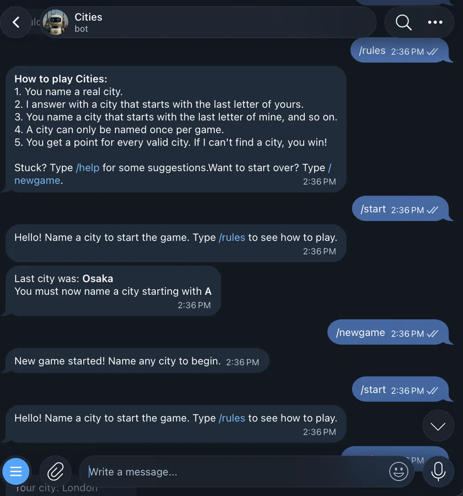

# Geo Chain Bot


A Python Telegram bot that plays a turn-based geography chain against the user: each city must start with the last letter of the previous one. Every turn pulls together data from four sources — GeoNames for city validation and coordinates, OpenWeatherMap for live conditions, Wikipedia for a summary, and Mistral AI for hints — with each user's game state stored in SQLite.

<p align="center">
  
</p>

## Features

- **City validation** against the GeoNames dataset, so only real cities are accepted and none can be repeated within a game.
- **Bot responses** chosen from the most populous cities that start with the required letter.
- **Map locations** sent for both the user's city and the bot's city.
- **Live weather** for the bot's city: conditions, temperature, feels-like, pressure and cloud cover.
- **Wikipedia summary** and link for the bot's city.
- **AI hints** via `/help`, which asks Mistral for three valid cities that haven't been used yet.
- **Persistent state per user** in SQLite, so a game survives bot restarts and `/start` picks up where it left off.
- **Graceful API failure handling**: if an external service is down or rate-limited, that part is skipped and the turn continues.
- **Parameterized SQL queries** throughout to prevent SQL injection.

## Commands

| Command | Description |
| --- | --- |
| `/start` | Register and start a game, or resume an existing one |
| `/rules` | Show how the game works |
| `/help` | Get three AI-suggested cities for the current letter |
| `/newgame` | Reset the score and city list |

## Tech Stack

- **Python** with [pyTelegramBotAPI](https://github.com/eternnoir/pyTelegramBotAPI)
- **SQLite** for per-user game state
- **geonamescache** for offline city data (names, coordinates, population, country)
- **OpenWeatherMap API** for current weather
- **Wikipedia API** for city summaries
- **Mistral AI API** for hint generation
- **python-dotenv** for configuration

## Project Structure

```
geo-chain-bot/
├── main.py           # Bot setup and Telegram command/message handlers
├── game.py           # City lookup, validation and the bot's move
├── apis.py           # Weather, Wikipedia and Mistral AI calls
├── database.py       # SQLite helpers and table setup
├── config.py         # Loads and checks API keys from .env
├── requirements.txt
└── .env.example
```

## Setup

You need **Python 3.10+** and three free API keys. Setup takes about 10 minutes.

### 1. Clone and install

```bash
git clone https://github.com/dmitry-milyutin/geo-chain-bot.git
cd geo-chain-bot

python -m venv venv
source venv/bin/activate        # Windows: venv\Scripts\activate

pip install -r requirements.txt
```

### 2. Create your Telegram bot

1. Open Telegram and start a chat with [@BotFather](https://t.me/BotFather), Telegram's official bot for creating bots.
2. Send `/newbot`.
3. Enter a display name for your bot (anything you like).
4. Enter a username for your bot. It must be unique and end in `bot`, for example `my_geo_chain_bot`.
5. BotFather replies with an **API token** that looks like `123456789:ABCdef...`. Copy it. Anyone with this token can control your bot, so keep it private.

**Optional:** to get the command menu in Telegram, send `/setcommands` to BotFather, pick your bot, and paste:

```
start - Start or continue the game
rules - How to play
help - Get city suggestions from AI
newgame - Restart the game
```

### 3. Get an OpenWeatherMap key

1. Create a free account at [openweathermap.org](https://openweathermap.org/api).
2. Go to the **API keys** tab in your account and copy the default key, or generate a new one.

New OpenWeatherMap keys can take a little while to activate. If weather doesn't show up at first, the bot will still run and skip that part.

### 4. Get a Mistral AI key

1. Create an account at [console.mistral.ai](https://console.mistral.ai).
2. Go to **API Keys** and create a new key.

The bot uses `mistral-small-latest`, which is available on the free plan. Free plans are rate-limited, so `/help` may occasionally ask you to wait a minute.

### 5. Add your keys

Copy the example file and fill in your three keys:

```bash
cp .env.example .env
```

```
TELEGRAM_TOKEN=your_telegram_bot_token_here
WEATHER_API_KEY=your_openweathermap_key_here
MISTRAL_API_KEY=your_mistral_api_key_here
```

`.env` is listed in `.gitignore`, so your keys are never committed.

### 6. Run

```bash
python main.py
```

The SQLite database is created automatically on first run. Open your bot in Telegram, send `/start`, and name a city.

## How a Turn Works

1. The user's message is checked against the previous city's last letter, the GeoNames dataset, and the list of cities already used.
2. The bot picks the most populous unused city starting with the required letter. If none exists, the user wins and the game resets.
3. The bot sends map locations for both cities, live weather for its own city, and a Wikipedia summary.
4. The updated city list and score are saved to SQLite.

## Limitations

- Only cities in the GeoNames dataset included with `geonamescache` are recognized, so very small towns may be rejected.
- Free API tiers have rate limits; when one is hit, the bot skips that feature for the turn instead of failing.

## Future Ideas

- Best-score tracking and a `/top` leaderboard
- "Did you mean...?" suggestions for misspelled cities
- Randomized bot responses so the same letter doesn't always get the same city
- Inline buttons for hints and restarting
- 24/7 hosted deployment

## Author

**Dmitry Milyutin** — [GitHub](https://github.com/dmitry-milyutin)